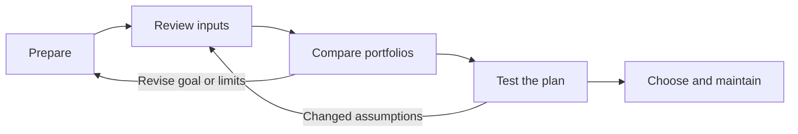

# Portfolio reconstruction proposal — 7 October 2026

Status: researched proposal, not an implemented or release-ready feature. Owner: Codex in chat 01a103b6-b5be-7760-afed-5b27b82a0530. [Source ledger](../source-audits/portfolio-reconstruction-2026-10-07.md).

## 1. The product requirement

Portfolio calculates allocations from a learner's goal, researched investment set, dated estimates and stated limits. **Weights are outputs throughout the normal journey.** Learners enter the facts and preferences needed to define the problem; they inspect, compare and choose the resulting portfolios.

This replaces the whole Portfolio section. Moving the October guide to another tab would leave the underlying product problem unresolved. Remove target-percentage inputs from the normal workflow, including the old main page and its empty states. A solver failure must lead to an explanation and a meaningful revision of inputs, never a requirement to invent weights.

The existing F7–F10 and M6–M7 requirements remain in scope: estimation, four advanced construction families, comparisons, blends, robustness, buying and operating rules. The implementation stages below order that work; they do not silently remove it. Broad-fund and individual-stock/bond workflows both remain supported.

## 2. What the current audit establishes

- Main at `be4609d` sends `/studio/portfolio` to `WorkspaceStage stage="build"`, which renders `BuildStage`. Its central control writes `targetWeightPct`; the heading tells learners to decide percentages and total them to 100%.
- `PortfolioNav` presents allocations, comparison, risk/cost, returns and buying as separate tools without a construction sequence. The old buying empty state sends the learner back to manual weights.
- `ece80bc` adds a separate guide but leaves that main route intact. It offers constrained equal spread and minimum monthly variance; the other requested methods are absent.
- The built-in return bundle supplies three exact fund histories: VTI, VOO and VXUS. Their common window is short. The curated universe also contains AGG, SGOV, AAPL, TSM and an individual Treasury. It is not a complete input pack for the advertised universe.
- Claude's independent 7 October review identifies two P1s: results on binding limits fail saving after dollar rounding; an incorrectly interpreted equality multiplier causes valid even-spread results with binding minimum ranges to fail validation and draft restoration. That review supersedes the earlier readiness assessment. This proposal does not claim those bugs are fixed.
- Existing research records, storage recovery, cash-flow arithmetic, source links and exports are valuable components to retain. The Portfolio workflow and calculation contract need replacement.

## 3. Source-backed design decisions

Vanguard's [cash framework](https://investor.vanguard.com/investor-resources-education/article/a-framework-for-considering-cash-in-your-portfolio) makes goal, horizon, funding and risk preference relevant to cash allocation. Its [investment principles](https://corporate.vanguard.com/content/corporatesite/us/en/corp/about-our-funds/how-we-invest/principles-for-investing-success.html) connect goals, diversification, cost and discipline. Our five-screen journey below is an original Investing Studio adaptation of those concerns, not a copy of Vanguard's proprietary allocation model.

Goldman's [1999 He–Litterman paper](https://people.duke.edu/~charvey/Teaching/BA453_2002/GS_The_intuition_behind.pdf) supports starting with an explicitly constructed prior and adding uncertain views. J.P. Morgan's [2026 assumptions page](https://am.jpmorgan.com/us/en/asset-management/adv/insights/portfolio-insights/ltcma/) illustrates institutional separation of return, volatility and correlation assumptions. Its horizon and distribution restrictions make it unsuitable as an automatic stock-return feed for this product.

The mathematical contracts use primary [MOSEK portfolio documentation](https://docs.mosek.com/portfolio-cookbook/markowitz.html), original research and official implementation documentation identified in the ledger. Institutional branding supplies no endorsement of Investing Studio's outputs.

## 4. One Portfolio journey

### Screen 1 — Prepare

Bring in the existing Goals and Research records. Show the goal amount/date, current money, contributions, dated spending needs, accessible reserve, acceptable loss and investment approach. Ask only for missing facts. Current owned shares or dollars are inputs for later trading; proposed weights are not.

The current `StudioGoal` stores available budget and horizon but no explicit future target amount/date. Extend it for a funded-goal mode; never treat the available budget as the desired future wealth. Keep a build-wealth mode for learners without a fixed monetary target, with risk-based choices and no invented shortfall target. Its starting proposal is the frontier candidate with the highest modeled return within the confirmed cash, loss and concentration limits, with sensitivity and concentration shown. Return-dependent selection requires a valid estimate set. Goals owns these facts once; Portfolio reuses them.

Let the learner choose a researched investment set, exclude an investment or add an explicit cap/restriction. Treat caps as limits, not required target allocations. Preserve currently zero-weight candidates and explain later zero allocations. A broad-fund approach can offer a maintained eligible fund set; an active-stock approach must use the actual companies researched.

Separate loss willingness from financial capacity. Store unset values separately from an explicit zero. Do not translate a short risk quiz into an undocumented stock percentage, volatility ceiling or optimizer coefficient.

Derive a **minimum protected cash amount** from the confirmed spending schedule and reserve. Show the calculation and have the learner confirm the financial facts. Account for spending and contributions on their actual dates, avoid double-counting a reserve and its bills, and distinguish cash outside the investing goal. Additional investment cash can vary where the model supports it; the protected bucket is identical across compared methods. This cash policy is an Investing Studio specification requiring its own audited examples.

Primary action: **Calculate portfolios**. No starting-weight form or mandatory method picker.

### Screen 2 — Review inputs

Supply maintained research snapshots for the curated universe. Import is an advanced option, not the basic way to make the product work. Each selected investment must have an explicit estimation route: exact security history, or a separately reviewed security-specific scenario/factor model. A new Treasury issue cannot acquire a long history by silently borrowing an older issue's returns.

Show dates, common observations, currency, dividend/split treatment, price versus fund-value basis, expected-return assumptions and covariance quality. Explain covariance positively as joint movement, with a concrete example before displaying its matrix. The main visual is an annotated relationship map; an exact matrix and source records sit behind disclosure.

Use a reviewed estimated covariance shrinkage method by default, with sample covariance as a comparison. Define the estimator variant, normalization and learned intensity. The previous arbitrary 25% blend and 12-month demonstration floor are not adequate release definitions. Quality policy must consider sample length, asset count, conditioning and stability; a preferred five-to-ten-year monthly window is our research policy to evaluate, not a source guarantee.

Expected returns are explicit model assumptions. Historical average returns and valuation upside are not automatically forecasts. Asset-class forecasts are not individual-stock forecasts. A market-equilibrium prior requires a defensible benchmark/universe; normalizing the few selected stock market caps does not create a global equilibrium portfolio. Where a valid stock-return prior cannot be built, risk-only methods remain available, while return-dependent metrics and goal-probability claims remain unavailable until their inputs are supplied.

Optional investment views use a stated expected difference and uncertainty range, introduced with a worked example. They do not require users to fill a return forecast for every investment. This is the optional Black–Litterman path, not another required form.

### Screen 3 — Compare portfolios

Automatically calculate the eligible methods on the same immutable investment/input/limit snapshot. Present a starting proposal plus explained alternatives on a risk–return plot and linked capital/risk bars. The plot appears only when comparable return estimates exist. The method names and equations are available in an explanation panel after their plain descriptions.

The proposed default selection rule is explicit Investing Studio policy: use the constrained frontier and select the lowest estimated-risk candidate that meets the modeled funding requirement and all confirmed hard limits; if none qualifies, say **No portfolio meets these assumptions**. A modeled return requirement is not a promise of reaching the goal. Confirm fit on Screen 4. If return inputs are unavailable, present calculated risk-only alternatives without pretending to select a goal-achieving optimum.

A learner changes objectives, investments or limits and recalculates. They do not drag holdings to author target percentages. Automatic equal-capital allocation is a reference comparison, not the primary proposal.

For each result explain the amount, its contribution to risk, overlap/concentration, which limits bind and why a candidate received zero. Verify explanations through a counterfactual rerun, such as removing a particular cap; do not invent causal prose from the largest multiplier alone. Save failed methods alongside successful ones.

### Screen 4 — Test the plan

Make deterministic stresses, historical demonstrations and simulated futures separate views. Test stocks, rates/credit, currency, concentrated issuers, cash deadlines and costs using the supported instrument models. Show which assumptions drive each result.

Simulations use the goal's dates and contribution/withdrawal schedule. Define terminal wealth, shortfall, cash exhaustion, drawdown and tail loss before asking the learner to interpret them. A scenario-loss ceiling, standard deviation and maximum drawdown are different quantities. No conversion among them by renaming labels.

Save seeds, path counts, horizon, distribution/dependence, inflation and rebalancing assumptions. Show finite-simulation uncertainty if a probability is reported. Use independent evaluation paths/windows where feasible; a retrospective optimized chart is not a strategy backtest. Regime changes, mean/covariance changes and turnover sensitivity must remain visible. Do not pick a method simply because it wins the same data used to tune it.

If the goal fails, offer recalculations for more contributions, a later date, a lower goal, different investments or revised limits. Explain the tradeoff and require an explicit change.

### Screen 5 — Choose and maintain

Choose a saved candidate with a recorded reason. Selection is explicit; previews and saved alternatives do not change the selected plan.

Generate the buying/rebalancing worksheet from selected targets, actual owned amounts, dated research prices, quantities, fees and cash. Show mathematical target fit separately from implementable shares/face values and cash after rounding. A non-executable worksheet cannot claim its original targets have been implemented.

Define operating rules for new money, spending, changed circumstances, changed evidence and allocation drift. A later review recalculates proposals and records action or inaction. Contributions should fund underrepresented positions through the calculation. The application places no orders and creates no reminders implicitly.

Export the same selected snapshot, alternatives, model/source assumptions, failed tests, research reasons, buying worksheet and review rules. Keep a readable plan, holdings CSV and restorable JSON backup.

## 5. Mathematical contracts

Notation: `w` is investment weights in the whole portfolio, `c` protected cash share, `Σ` the common risk covariance, `μ` modeled arithmetic return over the same period, and `C` the compiled constraints. Cash and investments satisfy `sum(w) + c = 1`; holdings are long-only. Different additional-cash policies must be flagged when comparisons differ.

| Calculation | Contract and output |
| --- | --- |
| Mean–variance / minimum variance | Solve `min w'Σw` with budget, hard limits and, when supported, a modeled return floor. Sweep feasible return/risk levels to form the frontier. A goal supplies a funding calculation, not a user-written holdings vector. |
| Maximum Sharpe | Solve for modeled excess return per unit standard deviation, `(μ'w + cash_return - rf) / σ`. State the period and cash convention. Zero risk or absence of a feasible positive-excess-return portfolio is an explicit unsupported optimization case under the positive-return transformation. It is a comparison candidate, not a universal goal rule. |
| Equal risk contribution | Under the covariance model, `RC_i = w_i(Σw)_i / sqrt(w'Σw)`. Seek equal contributions over the investing bucket. Additional caps may prevent exact equality: report residuals and label an approximate constrained version **Balance risk within limits**. Never describe constrained unequal contributions as exact risk parity. |
| Hierarchical risk parity | Cluster correlation-derived distances, order related investments, then recursively allocate between clusters. Preserve deterministic ordering/linkage. Standard HRP does not express arbitrary constraints. A closest feasible projection must be labeled **HRP-based allocation adjusted to limits**, with the original result, adjustment distance and binding limits retained. |
| Conditional value-at-risk | For scenario losses `L_s(w)` with probabilities `p_s`, solve `min z + sum(p_s*u_s)/(1-alpha)`, where `u_s >= L_s(w)-z` and `u_s >= 0`, under the same eligible hard constraints and optional modeled return floor. Define the loss sign, horizon and tail mass. Do not calculate discrete expected shortfall by blindly averaging observations strictly beyond a percentile. |

This preserves all four requested advanced families. Mean–variance includes minimum variance and maximum Sharpe as distinct objectives. The constraint-adapted HRP and risk-balancing variants are original product adaptations requiring independent validation.

Covariance proposal: lock the scaled-identity Ledoit–Wolf formulation documented by [scikit-learn](https://scikit-learn.org/stable/modules/generated/sklearn.covariance.LedoitWolf.html), `Σhat = (1-a)S + a*trace(S)/N*I`. Learn `a` from the data; record centering and the covariance denominator. Do not call the different constant-correlation estimator or the previous fixed off-diagonal blend the same implementation.

Black–Litterman proposal: use an explicit excess-return prior `π`, its uncertainty `Q`, view matrix `P`, view returns `q` and view uncertainty `Ω`. The posterior mean can be represented as `π + QP'(PQP' + Ω)^(-1)(q-Pπ)`. Record the benchmark, calibration, units and whether the portfolio risk covariance uses a predictive-uncertainty adjustment. No views returns the prior; weak views approach it. Each view must identify what information supports it, and shared evidence must not be counted twice as independent information.

Blends remain supported as advanced saved comparisons: generate an equal blend as a reference, or solve for the blend coefficients under the learner's stated risk/funding limits. The learner selects a tradeoff, not individual holdings percentages. Save and disclose `beta`, recalculate `w_blend = sum(beta_k*w_k)` and every metric from that vector. Variance, volatility, tail loss and costs cannot be obtained by averaging the displayed candidate metrics.

## 6. A verified teaching example

These are invented Investing Studio inputs, not security forecasts: two uncorrelated investments, annual volatilities 10% and 20%, modeled annual arithmetic returns 6% and 9%, and a 2% risk-free rate. No caps or costs in this small calculation.

| Method | A / B within investing money | Estimated volatility | A / B / cash with 20% cash fixed |
| --- | --- | --- | --- |
| Equal capital reference | 50.00 / 50.00 | 11.18% | 40.00 / 40.00 / 20.00 |
| Minimum variance | 80.00 / 20.00 | 8.94% | 64.00 / 16.00 / 20.00 |
| Equal risk contribution | 66.67 / 33.33 | 9.43% | 53.33 / 26.67 / 20.00 |
| Maximum Sharpe | 69.57 / 30.43 | 9.24% | 55.65 / 24.35 / 20.00 |

Volatility in the table refers to the investing bucket before fixed cash. With a cash proxy modeled as risk-free over the same period, whole-portfolio volatility scales by 0.8. This example teaches why different objectives produce different weights. It does not identify a superior method.

Independently recalculated evidence is saved in `tmp/portfolio-reconstruction-research-2026-10-07/independent-math.json`. A discrete tail test with equally likely losses `[1,2,3,4,20]` and a 70% confidence level gives a worst-30% expected shortfall of 14.6667, using one whole observation plus half of the next. Production tests must reproduce these cases without borrowing the implementation's expected answers.

## 7. Inputs and data are part of the reconstruction

Release requires a complete, maintained research pack for all advertised curated holdings. Start with the existing exact SEC fund-class reports, issuer documents and security identities. Extend equity/fund market-price total-return history through a provider with verified adjustment definitions and distribution rights; [Alpha Vantage documentation](https://www.alphavantage.co/documentation/) is one investigated candidate, not a selected entitlement or purchased feed. Filings supply business evidence, not a full stock price history.

The first implementation work must establish the actual data contract, available history and allowed display for VTI, VOO, VXUS, AGG, SGOV, AAPL and TSM, plus a reviewed cash-flow/rate model for the Treasury. Check ADR units, currencies, distributions, splits, fund expenses, maturity and accrued interest. Keep source, observation dates, retrieval date and transformations for every series. Provide a visible as-of date and meaningful update policy; do not add live market feeds merely to create motion.

J.P. Morgan's page explicitly says the material is not for retail distribution and its forecasts concern 10–15 years. Do not bundle those matrices or apply them to a single stock without an appropriate data agreement and transformation model. Goldman/Vanguard materials support methodological research; proprietary models and research PDFs are not product assets to redistribute.

Missing data blocks the affected calculation with a recovery route. It does not silently drop an investment, fill returns with zeros, relabel an index proxy as security history or ask the learner for replacement weights. Custom investments remain visibly outside automatic coverage until an audited input route exists. A launch that requires users to source missing histories for the basic curated universe is incomplete.

## 8. Numerical and storage architecture

Create versioned, immutable `PortfolioProblem`, `EstimateSet`, `AllocationRun`, `EvaluationRun`, `SelectedPlan` and `ImplementationWorksheet` records. User facts/constraints, estimate choices, generated targets, actual holdings and trade quantities have separate meanings. Frozen run data survives future estimate updates; staleness is shown without rewriting history.

Compile constraints once into a canonical model shared by calculations and checks: long-only/budget; protected cash; holding and asset-class bounds; industry and aggregate-issuer limits; scenario-loss limits; and explicit turnover/cost restrictions where supported. Fund look-through requires dated exposure coverage; unknown exposures cannot be counted as zero or certified as satisfying an issuer limit. Free-text restrictions need a confirmed structured meaning before automatic enforcement. Distinguish cash from a Treasury ETF's market value and trading liquidity.

Use decimal money at the account boundary, whole-portfolio fractions inside models and explicit conversions. UI rounding never changes solved weights. Verify imported objectives, data, covariance, constraints, budgets and outputs, not only the shape of a result object. Every return, covariance, risk-free reference and scenario uses a declared compatible period and currency. Geometric long-term forecasts cannot be divided by twelve and inserted as monthly arithmetic means; conversion requires an explicit model. Annualizing historical covariance requires its own dependence assumption.

Lock HRP's distance and linkage convention, including whether clustering uses direct correlation distances or distance profiles, its ordering/tie policy and the corresponding reference implementation. Lock Black–Litterman's prior calibration, uncertainty and covariance convention before comparing variants. Primary equations and a similarly named library routine are not proof of identical implementations.

Recommend an audited numerical service for advanced solves, with browser workers for preparation, cancellation and nonblocking visualization. Build the reference implementation with maintained modeling/solver tools: [CVXPY](https://www.cvxpy.org/) and appropriate open solvers, plus independently verified estimation/clustering. MOSEK is a formulation reference, not a required commercial purchase. Pin versions and confirm licenses, runtime and deployment support before deciding the production package set. Guest project data remains local; numerical requests should contain only required arrays and constraints, with their transport/storage documented. No account requirement is introduced by the solver.

The service contract returns method-specific diagnostics, status and residuals, handles cancellation/time limits and preserves the failure result. A browser-only production design is acceptable only after equivalent maintained solver capability and correctness are demonstrated; it must not be chosen by inventing missing algorithms. Do not copy the author's HRP source into the product without resolving its stated commercial-use conditions.

Repair the October failure classes in the shared contract: equality multipliers retain the formulation's correct sign; independent stationarity checks match the actual solver objective; budget/constraint certification uses frozen facts. Separate floating residual tolerance from financial rounding. Store a valid mathematical candidate even when a separate executable worksheet requires repair. A cent/unit-constrained worksheet must either satisfy its stated limits or explain a concrete implementation failure; repeated regeneration of an identical unsavable result is unacceptable. Do not hide violations by widening user limits.

Upgrade the persistence schema through versioned migrations with backups and rejection recovery. Preserve legacy manual plans as dated records that can be recalculated. Document rollback compatibility; older readers must not be released over new saved schemas they cannot read. Import/export and the UI use the same saved snapshot. No cosmetic optimizer title survives a later altered target vector.

## 9. Routes, visuals and teaching

`/studio/portfolio` becomes the authoritative journey entry and resumes the current step. Replace the five current tool tabs with the five journey screens. Keep existing `/weights`, `/returns`, `/risk` and `/buying` URLs as redirects or context-specific subviews, so old links resolve without restoring the obsolete manual page. The bond calculator remains an instrument tool, not a second portfolio starting point. Reuse Goals/Research records and global Review rules instead of duplicating forms.

Use the portfolio constellation to show linked exposures, an efficient-frontier chart for eligible comparisons, separate capital/risk bars to explain unequal contributions, a cash timeline for spending and one scenario result at a time. Each interaction changes a calculation, its assumptions or the chosen decision. Avoid a collection of decorative strategy cards. Preserve the established theme; use Inter for UI/numbers and Fraunces for headlines.

Introduce each method's idea with the verified two-asset case; give a guided comparison before independent selection. Define expected return, volatility, covariance, risk contribution, tail loss and uncertainty before required use. No finance acronym in navigation. Use keyboard-operable controls, visible focus, semantic tables, alternatives to color, reduced-motion behavior and a usable coarse-pointer phone.

Each screen is measured at 390/768/1024/1280/1440/1920 with the 1.5-screen limit. One hero, controls before excessive preamble, paged holdings, details behind disclosure and mobile comparison one candidate at a time. Source, pedagogy, wording, calculation, accessibility and visual review are separate gates; the current guide's screenshots do not verify the replacement.

## 10. Implementation order and completion gates

| Stage | Deliverable | Required exit evidence |
| --- | --- | --- |
| A — problem and data contracts | Complete source mapping, actual curated-data coverage, cash/goal conventions, exact estimator and method formulations; runtime/data rights decisions | Every claimed supported investment has a valid input route; no unknown numerical units; no compulsory target weights |
| B — independent numerical engine | Reviewed shrinkage/prior/view inputs; mean–variance and Sharpe; ERC and constrained risk balancing; HRP and disclosed projection; CVaR; blends | Analytic cases, independent reference solves, random feasible/infeasible cases, dual-sign and cent-rounding reproductions, deterministic clustering, correct tails and source replay |
| C — replace Portfolio journey | Main route and all deep links use the new screens; automatic generation, explanations and saved candidates; obsolete manual controls retired | Fresh learner completes both broad-fund and active-stock journeys without entering a target weight; persistence/refresh/failure recovery works |
| D — goal tests and operation | Scenarios, historical comparison, uncertainty/simulation, buying/rebalancing and operating rules use the selected snapshot | Cash deadlines and unit/cost conventions independently verified; held-out/sensitivity evidence visible; selection never places orders |
| E — migration and release review | Old/new backups, schema upgrade/rollback strategy, readable output, full journey and all-width audits | Full unit/e2e/type/lint/build checks, independent numerical and learner review; no P0/P1; every required family and supported data route present |

Definition of done: the normal user can reach a calculated, explained, tested, saved and usable target plan with no per-investment target-percentage input. All four requested advanced families and their constraint qualifications are present. Data, failures, sources, estimates, costs and original product choices are visible. Do not declare completion after only changing the entry route or restoring the October two-method guide.
