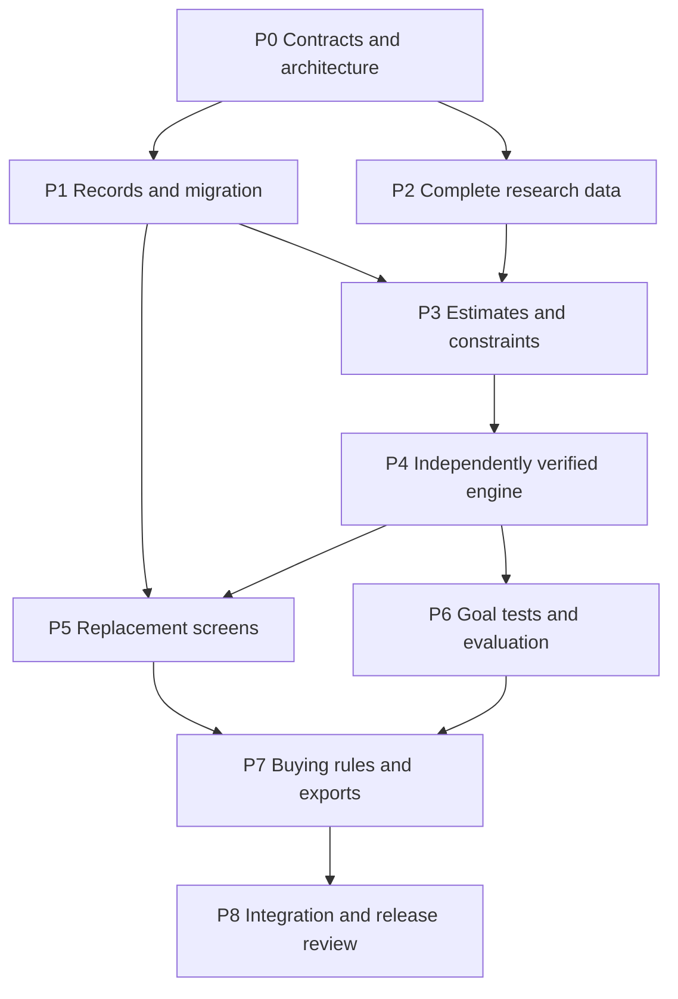

# Portfolio reconstruction implementation plan

Date: 7 October 2026, America/Phoenix. Status: ready to execute as an implementation plan; product work has not started in this task.

Controlling direction: [accepted reconstruction proposal](../design/portfolio-reconstruction-2026-10-07.md). Evidence: [research source ledger](../source-audits/portfolio-reconstruction-2026-10-07.md), the original Studio F7–F10/M6–M7 handoff, and Claude's 7 October review of `ece80bc` in the primary checkout's `tmp/agent-coordination/claude-guidance-review.md`.

**Completion rule: Portfolio calculates the weights. A learner can complete the ordinary journey without entering an investment's target percentage.** This plan replaces the main Portfolio section and its deep links; an additional optimizer tab is not a deliverable.

## 1. Baseline and working agreement

- Inspected primary baseline: `be4609d06476e4eddde98728859ac1fb143e265b`. Confirm the latest accepted integration base when implementation begins.
- The `ece80bc` guide is a reference prototype, not an integration base to cherry-pick wholesale. Retain its useful fixtures and numerical cases; independently revalidate reused code. Its two P1s and incomplete data/method coverage remain open.
- Preserve primary configuration edits, coordination changes, research documents, all other worktrees and old source records. Do not overwrite another agent's copy to obtain a clean build.
- Implementation owner controls the integration branch, shared schema/adapters, route retirement and numerical contracts. An independent reviewer checks math, sources, learner sequence and integration. These are proposed roles, not messages or assignments to another chat.
- At implementation startup, read current shared records and attached worktrees. Reuse a suitable isolated checkout when safe; otherwise create a managed worktree from the confirmed base with branch prefix `codex/`, suggested branch `codex/portfolio-reconstruction`. Record exact owned files, branch, worktree, free port and processes before writing or building.
- Each work package has one writer. Data and engine work can run separately after contracts are fixed. Schema/integration files have one integration owner. A worktree's `.next` has one build/server owner.
- Local implementation, reviewable commits and validation are the work products. Paid data purchases, external publication and brokerage execution are not assumed by this plan.

## 2. Scope that must survive implementation

The normal Portfolio journey has five screens: **Prepare → Review inputs → Compare portfolios → Test the plan → Choose and maintain**.

The completed calculation layer contains all four requested advanced construction families: mean–variance/maximum Sharpe, equal risk contribution, hierarchical risk parity and conditional value-at-risk. It also contains estimated covariance shrinkage, optional Black–Litterman views, computed blends, constraint diagnostics and reproducible evaluations. Methods that need unavailable estimates report that limitation; a differently named method is never substituted under the original label.

Both broad-fund and active-stock/bond journeys must work. A narrow fund-only demo cannot satisfy this completion boundary. Legacy records remain readable, but manual target-percentage forms disappear from the normal UI and old `/weights` entry points.

## 3. Proposed component boundaries

Names below are intended new modules, not claims that these files already exist.

| Boundary | Proposed location | Responsibility |
| --- | --- | --- |
| Product records and migration | Existing `lib/studio-project/` | Project schema, snapshots, decisions, validation, storage/recovery and legacy imports |
| Portfolio contracts and pure calculations | New `lib/portfolio/` | Goals/cash schedules, estimate/constraint contracts, input preparation, result checks, metrics, explanations and worksheets |
| Maintained research snapshots | `lib/studio-project/data/portfolio/` and `scripts/source/` | Audited security identities, histories, scenarios, prices and exposure manifests; no network fetch during render |
| Numerical implementation | Proposed `services/portfolio-engine/` | Reference/production solver service, versioned request/result schema, method-specific diagnostics, cancellation and deterministic calculations |
| Client orchestration | `lib/portfolio/portfolio.worker.ts`, client adapter | Preparation, nonblocking evaluation, request orchestration, stale-result protection and cancellation |
| Learner screens | New `components/studio/portfolio/` | Five screens, linked charts, source disclosures and failure recovery |
| Route/shell integration | Existing Studio workspace routes and frame | Main entry, step navigation, deep-link compatibility, selected snapshot and global review |

Default architecture is the researched numerical-service approach. Work package P0 must prove that its runtime, guest/local behavior and operational requirements can be supported. A browser-only solver is an alternative only after equivalent method capability and independent correctness are demonstrated. Do not decide the architecture by reducing the methods.

## 4. Dependency order

Screens can be designed against frozen fixtures while data/engine work proceeds. They remain an internal preview until the production-input and engine gates pass. P5 is not a partial public release or permission to declare the reconstruction complete.

## 5. Work packages

### P0 — Lock the problem, source and runtime contracts

**Deliverables**

- A short architecture decision record and versioned JSON contract for requests/results shared by TypeScript and the numerical runtime.
- A formula/source matrix for every estimate, objective, hard constraint, metric, cash convention and explanation. Separate reviewed equations from original Investing Studio selection/teaching policies.
- A data-coverage matrix for VTI, VOO, VXUS, AGG, SGOV, AAPL, TSM and the exact curated Treasury; additional individual bonds use an explicit security-model contract.
- Exact decisions for return frequency/currency, arithmetic versus geometric return inputs, covariance normalization, Ledoit–Wolf variant, Black–Litterman prior/uncertainty, HRP distance/linkage/ties, risk-balancing approximation and tail-loss horizon/probabilities.
- A runtime spike proving QP, conic/positive-return Sharpe, LP/scenario-tail, risk-budget and clustering capability with maintained packages. Pin the tested package/runtime versions and document deployment/licensing requirements. Author reference code is not executed or vendored merely because it was downloaded.
- Freeze the funded-goal versus build-wealth selection rules, protected versus additional cash, and what each risk measure means. An acceptable stress loss is not automatically a volatility ceiling or drawdown guarantee.

**Planned files:** `docs/design/portfolio-engine-architecture.md`, `docs/source-audits/portfolio-engine-formulations.md`, `lib/portfolio/contracts.ts`, `services/portfolio-engine/contracts/`, data manifest specification.

**Exit gate:** at least one independently verified example per required family can be expressed by the chosen runtime; every initial security has a documented feasible input route; no guessed entitlement, covariance convention, risk-to-weight mapping or benchmark remains in the contract. A data/runtime dependency that cannot be resolved is recorded as a bounded blocker, with unaffected work continuing.

### P1 — Add versioned records and recoverable migration

**Tasks**

- Design project schema v3 while preserving v1/v2 input readers and recovery records. Migrate the October generated-run prototype through an explicit reader; do not interpret its optional fields as proof of a verified result.
- Add funded-goal amount/date, build-wealth mode, dated contribution/withdrawal events and confirmed reserve facts. Keep available budget distinct from future desired wealth. Unset facts remain unset.
- Store versioned `PortfolioProblem`, `EstimateSet`, `AllocationRun`, `EvaluationRun`, `SelectedPlan` and `ImplementationWorksheet` records. Each run has its method/variant version, canonical input hash, source window, result, status and diagnostics.
- Separate researched candidate membership, actual owned positions, generated target weights and executable quantities. Selecting or removing a portfolio holding must not erase research.
- Freeze input snapshots and invalidate only results affected by a changed dependency. Historical runs remain readable; no automatic rewriting of a chosen plan.
- Keep local guest access, practice/personal separation, cross-tab conflict handling, unsaved-draft export and transaction/recovery guarantees. Numerical-service use does not introduce an account requirement.
- Specify portable backups and their size budget. Store used input windows and deterministic evaluation recipes; do not store every simulated path in a project. Referencing a remote cache alone must not make a restored calculation unreproducible.

**Planned writes:** `lib/studio-project/{schema,validate,migrate,create,operations,workspace,backup}.ts`, related tests; change `session.ts`/`storage.ts` only where the new record contract requires it. These are shared files owned by the integration writer.

**Exit gate:** old plain/manual and generated records import without loss; incomplete projects remain editable; invalid/future schemas cannot overwrite saved work; backup/restore reproduces dated records; rollback/forward-reader policy is documented before new-schema publication.

### P2 — Supply complete, maintained research inputs

**Tasks**

- Audit existing fund reports, total-return snapshots, catalog prices, stock investigations, cash-flow/rate data and source scripts. Reuse only verified scope. A verified month-end price is not a total-return history.
- Add adjusted return histories for all advertised initial funds and stocks, using exact listing/share-class identity, dates, distributions, corporate actions and currency. Verify source access and allowed product display/export before choosing the feed. Do not assume a public URL grants redistribution rights.
- Implement the Treasury's dated cash-flow/yield scenario route; audit corporate-bond extensions before advertising them. Do not extend a new issue's history using an older issue under the same identifier.
- Supply dated risk-free/cash assumptions and issuer/industry/fund exposure coverage. A cash-like ETF remains an investment with its own model, not an interchangeable bank-cash balance.
- Implement build-time/offline snapshot ingestion, source metadata, checksums, rejected-source diagnostics and an update procedure. No live market-data request is added to the interactive page by default.
- Align exact periods, detect missing/duplicate observations, and record each transformation. Missing selected investments remain visible. Proxy/model-based inputs, if audited, are separately identified and never relabeled as security history.

**Planned writes:** `scripts/source/build-portfolio-research.mjs`, new manifest/data files under `lib/studio-project/data/portfolio/`, `lib/portfolio/{research-inputs,alignment,data-quality}.ts`, fixture and ingestion tests. Existing price/return readers get explicit adapters rather than silent convention changes.

**Exit gate:** the ordinary curated-universe journey requires no learner CSV import; every advertised investment has a usable input route; independent source spot checks and transformation calculations pass; short/unsupported custom histories are explained. Do not resolve this gate by removing active stocks or individual bonds from scope.

### P3 — Implement estimates, cash/goal calculations and canonical constraints

**Tasks**

- Build confirmed cash schedules and protected-cash calculations with dated bills/contributions and no double counting. Confirm that money outside a goal is excluded consistently from its funding calculation.
- Implement observed covariance and the locked estimated shrinkage variant, with numerical matrix checks and metadata. The prior fixed 25% blend and 12-month demonstration floor are not the production estimation contract.
- Construct defensible expected-return assumptions separately from historical observations. A stock-price valuation gap, historical mean or asset-class CMA must not silently become a stock forecast. Return-dependent methods/metrics require eligible inputs; risk-only methods are marked accordingly.
- Implement the locked prior/view update with documented benchmark, uncertainty and units. Empty/weak views recover the specified prior. Prevent duplicate evidence from being treated as independent confidence.
- Compile a single model for budget, nonnegative holdings, reserve, holding/asset-class bounds, issuer/industry coverage, scenario loss and supported turnover/cost limits. Parse free-text restrictions only after their structured meaning is confirmed.
- Use whole-portfolio weights internally. Make any legacy after-reserve conversion an explicit tested adapter. Validate basis, arithmetic/geometric conventions, cash return and horizon before calculation.
- Add input hashes and dependency tracking shared by every method and UI check. No selected asset is dropped because the estimator or solver dislikes it.

**Planned files:** `lib/portfolio/{goal-funding,cash-policy,estimates,prior-views,constraints,units,input-snapshot}.ts`, corresponding numerical-runtime modules and independent fixtures.

**Exit gate:** independent cent/date/frequency and small matrix cases pass; unchanged inputs produce identical estimate/constraint records; unsupported data is rejected before solving; current and frozen facts cannot be mixed.

### P4 — Build and verify all allocation methods

**Implementation order:** minimum variance/frontier → maximum Sharpe → exact risk budgets and constrained risk balancing → HRP and explicit constrained projection → scenario CVaR → computed blends.

- Mean–variance: feasible frontier, reserve/budget constraints, return floors and common hard limits; explicit infeasible/unbounded/numerically failed statuses.
- Maximum Sharpe: the locked positive-excess-return formulation, period-matched risk-free rate and transformed constraints. Handle zero variance, no positive-excess-return solution and fixed/additional cash explicitly.
- ERC: exact risk contributions where feasible; the source-reviewed constrained formulation reports unequal residuals rather than claiming exact parity.
- HRP: deterministic linkage/order; check the native result against limits. A projection is a separately named result with its parent, distance and changed contributions retained.
- CVaR: scenario loss signs/probabilities and partial mass at quantile ties; include the chosen return floor/constraints and tail definition in the saved record.
- Blends: calculate coefficients under the chosen candidate-level goal/risk constraints, retain an equal-blend reference, then recalculate every portfolio metric from the resulting holdings vector.
- Return reproducible method-specific diagnostics. Convex solves get suitable feasibility/optimality checks; a clustering procedure or approximate/nonconvex method must not inherit a false generic KKT/global-optimum certificate.
- Keep canonical data, eligible constraints and cash conventions common across comparisons. Surface and label every method-specific difference.
- Implement cancellation, timeouts, response/input-hash matching, stale-response rejection and source/runtime error recovery. Run expensive preparation/evaluation outside React rendering.
- Separate raw mathematical targets, displayed percentages, decimal target amounts and later executable trades. Validate each at its own boundary.

**Planned writes:** `services/portfolio-engine/{estimators,models,diagnostics,api}/`, reproducible environment/lockfile and reference tests; `lib/portfolio/{engine-client,verify-run,metrics,blend,portfolio.worker}.ts`; optional Next proxy route `app/api/studio/portfolio/route.ts` once transport/privacy behavior is reviewed.

**Mandatory regression cases:**

1. Exact two-asset minimum variance 80/20, ERC 2/3–1/3 and maximum Sharpe 16/23–7/23 under the proposal's invented inputs; whole-portfolio scaling with fixed cash.
2. Practice defaults, six curated holdings and the binding loss limit: calculate → save → reload → select succeeds for a valid mathematical candidate. Cent/unit feasibility is reported separately and truthfully.
3. VTI/VXUS/AGG with bonds at least 70%: 15/15/70 even-reference result survives run validation, saving and draft reload. Equality dual sign is checked against the actual formulation.
4. Valid solutions just on stock/holding/loss limits; awkward dollar amounts, positive reserves, cash above reserve, zero loss capacity and binding minimum ranges.
5. Mathematically infeasible models and known just-feasible cases, using independent reference solves; no false method relabeling or limit relaxation.
6. Tampered budget/reserve, removed constraints, altered covariance/series and suboptimal imported results rejected; legitimate frozen older goals remain valid but stale for current selection.
7. ERC approximation residuals, HRP tie/order reproducibility and projection labels; pure and constrained results do not acquire each other's names.
8. Discrete expected-shortfall partial-mass case (14.6667 at the specified 70% confidence); a blend's risk is recalculated rather than averaged.

**Exit gate:** every family passes independent analytic/reference cases and an appropriate randomized constraint sweep; finance/numerical reviewers resolve all blockers; exact version/input snapshots replay; supported results save and reload. The October unit/browser pass counts are historical evidence, not this gate.

### P5 — Replace the Portfolio screens and all entry paths

**Screen tasks**

1. **Prepare:** reuse Goals/Research, collect only missing facts, show calculated reserve and eligibility. No starting percentages and no compulsory optimizer-name picker.
2. **Review inputs:** dated evidence, quality/recovery, relationship map and estimate/view disclosure. Definitions and the checked two-asset example precede independent interpretation.
3. **Compare portfolios:** calculated starting proposal and alternatives, linked frontier and capital/risk bars, binding-limit and zero-weight explanations. Return charts/labels exist only for comparable valid estimates. Explanations relying on a constraint's effect use a verified counterfactual calculation.
4. **Test the plan:** shell/state integration for P6's evaluated results; no placeholder probability or fabricated scenario outcome.
5. **Choose and maintain:** saved reason, explicit selection, P7's worksheet/rules; selecting a preview does not place orders or destroy alternatives.

**Routing and integration**

- Replace `/studio/portfolio`'s `WorkspaceStage stage="build"` entry with the new journey and resumable step state.
- Replace `PortfolioNav` tool tabs with journey navigation. Update global frame, overview next action, Goals/Valuation links, buying empty states and Research return links.
- Resolve old `/weights`, `/returns`, `/risk` and `/buying` URLs to the appropriate new step/subview, preserving a valid saved proposal/comparison reference. Do not merely redirect a URL while retaining the manual workflow behind it.
- Preserve the bond calculator as an instrument subtool and global Review as operating rules, without duplicate goals or a second Portfolio starting point.
- Remove target-percent controls from normal Portfolio surfaces. Keep legacy allocations as readable historical decisions and enable recalculation from their facts. Any future expert experiment is outside the ordinary journey and is not a fallback.
- Finish source/loading/empty/failure/cancel/stale/unsaved/conflict states and screen focus before visual polish. Editing a factual input never silently changes the selected plan.

**Planned writes:** new `components/studio/portfolio/{PortfolioJourney,PrepareStep,InputsStep,CompareStep,TestStep,ChooseStep,PortfolioCharts}.tsx` and styles; workspace `PortfolioNav`, `StudioFrame`, `OverviewView`/`OverviewDashboard`, `GoalsWorkspace` and applicable entry links; Studio Portfolio route files; remove/retire Portfolio references to `BuildStage` and the old `PortfolioWeightsWorkspace` under the integration owner's control.

**Exit gate:** a fresh broad-fund and active-stock learner reaches calculated alternatives without supplying a target weight; all old links recover; supported results survive navigation and reload; vocabulary, keyboard, focus, coarse-pointer and screen-budget checks pass for each new state. Algorithm names belong in explanations after definitions, not unexplained navigation labels.

### P6 — Implement goal fit, robustness and evaluation

- Funded goals use target/date and timed cash flows; build-wealth goals use their documented objective and no invented shortfall amount. Implement the proposal's candidate-selection rules explicitly and retain rejected/failed candidates.
- Test deterministic stock/industry, rate/credit, currency, issuer and cash/cost scenarios within each supported instrument model.
- Integrate historical comparison with stated return/cash-flow/rebalancing conventions. Distinguish a retrospective illustration from a strategy's walk-forward evaluation.
- Implement seeded simulation, saved horizon/path count/dependence/distribution/price assumptions, timed cash flows and rebalancing. Show uncertainty of simulated probabilities and distinct terminal-wealth, shortfall, cash-exhaustion, drawdown and tail metrics.
- Test sensitivity to expected returns, correlation/volatility, costs and withdrawal dates; use separate evaluation windows/seeds where appropriate. No repeated tuning followed by a claim of independent performance.
- Provide useful recalculation paths for contributions, date, goal, universe and limits, with explicit user changes. No silent relaxation to make a goal pass.

**Planned files:** `lib/portfolio/{evaluation,scenarios,simulation,sensitivity,candidate-selection}.ts`, worker/runtime counterparts, `TestStep`, historical-comparison adapters and numeric/e2e fixtures.

**Exit gate:** funding and cash timing cases are independently calculated; seeds and recipes reproduce results; unsuitable/unavailable metrics are absent or explained; changing an assumption invalidates the correct evaluation; no default candidate is labeled goal-fitting before the necessary checks pass.

### P7 — Produce usable buying, review and export records

- Derive target dollars and orders from the selected immutable target, actual holdings, dated source prices, quantities, fees and accrued interest. Keep mathematical target fit separate from executable quantities/cash.
- Implement deterministic cent/unit handling and explicit repair or non-executable status. Never resolve a rounding failure by asking the learner to retype weights or widening a limit.
- Apply new contributions/spending through the calculation and explain the result. Distinguish research snapshots from executable broker quotes; preserve optional dated overrides.
- Define percentage-point versus relative drift, review dates, changed evidence/circumstances and action/inaction records. Do not create a background reminder service implicitly.
- Export the same selected snapshot and source dates seen in the UI, along with alternatives, estimates, evaluation, reasons, worksheet and rules. Keep readable plan, holdings CSV and restoreable JSON.

**Planned writes:** `lib/portfolio/{worksheet,rounding,review-rules,export}.ts`, `ChooseStep`, legacy arithmetic/export adapters in `lib/studio.ts` and `lib/studio-project/workspace.ts` only where necessary; buying/review route integration and regression tests.

**Exit gate:** budget, prices, fees, face-value/share units and remaining cash reconcile; any practical shortfall is visible; save/choose never trades; exported and restored state agrees with the UI; subsequent review/contribution journeys require no manual target entry.

### P8 — Integrate and complete independent release review

- Recheck current ownership, integrate ordered commits, identify the exact combined revision and verify runtime/package compatibility in the actual deployment environment.
- Exercise old v1/v2 backups, prototype generated records, fresh v3 projects, failed migration recovery, practice/personal separation, cross-tab conflicts and roll-forward/rollback procedures.
- Run the complete fresh journey in practice and personal modes; include broad funds, stocks, a bond, zero-weight candidates, many holdings, insufficient history, infeasible constraints, solver/service failure, cancellation, changed inputs and saved-plan reviews.
- Run source-integrity, finance, learning-sequence and wording reviews separately. New course content requires the repository's full source/coverage rules; implementation docs do not replace them.
- Run full relevant unit suites, typecheck, lint and production build. Run the full browser suite after changed names/routes, including the native storage suite. Record failures/skips and resolve regressions; do not skip obsolete text assertions instead of updating them.
- Capture and read screenshots at 390, 768, 1024, 1280, 1440 and 1920 for all main/failed/result states, including eight holdings and a touch phone. Maximum 1.5 screens at the required geometry, no sideways/nested working scroll, correct fonts/theme, readable controls and accessible focus/reduced motion.
- Preserve commit/patch, source/hash manifest, numerical checks, learner findings, logs, screenshots and reviewer handoff. Use the established release evidence directory.

**Exit gate:** no P0/P1; all four method families and their qualifications are present; initial data coverage is complete; all required journeys work without target weights; migration and practical worksheets pass. A published release requires its separate authorized release action.

## 6. Proposed integration batches and ownership

These are change boundaries for future implementation, not PRs already opened or promises that multiple agents are running.

| Batch | Work packages | Write owner / review emphasis |
| --- | --- | --- |
| 1 — contracts and runtime decision | P0 | Integration owner; mathematical/source and runtime review |
| 2 — project v3 and migration | P1 | Integration owner exclusively; storage/recovery review |
| 3 — complete research inputs | P2 | Data owner if explicitly delegated; source/units/rights review |
| 4 — estimation and constraint compiler | P3 | Engine owner; independent estimate/constraint cases |
| 5 — all construction methods | P4, optionally split into two reviewable solver batches | Engine owner; numerical reviewer compares independent results |
| 6 — main journey and route replacement | P5 | UI owner; integration owner changes shared adapters/navigation |
| 7 — evaluations and selection rules | P6 | Evaluation owner; finance/pedagogy review |
| 8 — operation and complete integration | P7/P8 | Integration owner; end-to-end, storage and six-width review |

With one implementer, execute these sequentially. With human-authorized parallel work, P1 and P2 can proceed independently after P0; screen/teaching design can proceed against the agreed fixtures while P3/P4 are built. Shared schema, constraint contracts, source registries, package/configuration and route integration remain single-writer work. A quiet record does not transfer ownership.

## 7. Test/evidence ledger to create during implementation

Create `docs/release-evidence/portfolio-reconstruction.md` with a row for every package: status, exact revision, source/fixture reference, command, result, independent reviewer and unresolved issue. Keep the status incomplete until direct evidence closes its exit gate.

Use named tests for meaningful behaviors: project v3 migration/backup; identity/return alignment; goal/cash timing; covariance/prior/view limits; constraint equivalence; analytic/reference allocations; boundary rounding/equality multipliers; save/reload/choose; native storage recovery; no-target-input journeys; sensitivity/evaluation; worksheets/export; old links; vocabulary; screen height and visual judgment. Do not substitute a test that merely repeats a formula implementation for independent verification.

No completion percentage or completion date is asserted before P0 resolves the data and production-runtime dependencies. Progress is measured by closed package gates and working complete journeys.

## 8. First implementation session

1. Read current cooperation records and choose the isolated checkout/base; record owned paths and processes.
2. Freeze the P0 JSON/problem contracts and open the architecture/source/data decision records.
3. Preserve and independently reproduce the two October P1s as failing reference/browser cases without editing Claude's review tree.
4. Prove the chosen runtime on the analytic examples and inventory actual coverage for all eight initial holdings.
5. Close P0; then begin P1 and P2. The first user-facing integration follows the verified engine and migration, with the whole replacement held for P8 release review.

## 9. Final acceptance checklist

- [ ] All normal target-percentage inputs and manual-first entry paths retired.
- [ ] Goal/current money/cash needs/risk facts determine the problem; weights are computed.
- [ ] Complete usable inputs for every advertised initial investment, with dates and honest gaps.
- [ ] All four advanced construction families, estimates/views, blends and method-specific qualifications implemented.
- [ ] Valid binding-limit results save and reload; dual signs, monetary facts and rounding behave correctly.
- [ ] Compared methods use common compatible inputs/limits or clearly disclose differences.
- [ ] Goals, stress, histories, simulation/sensitivity and operation use the same saved target/input records.
- [ ] Learners can explain the result and make an explicit selection; no silent trade or plan replacement.
- [ ] Existing work migrates recoverably; new records/backups have a safe rollback/forward-reader policy.
- [ ] Independent sources/math/teaching reviews and full functional/accessibility/six-width gates pass.
- [ ] Exact integrated revision and release evidence retained; partial method/UI delivery is not called complete.
